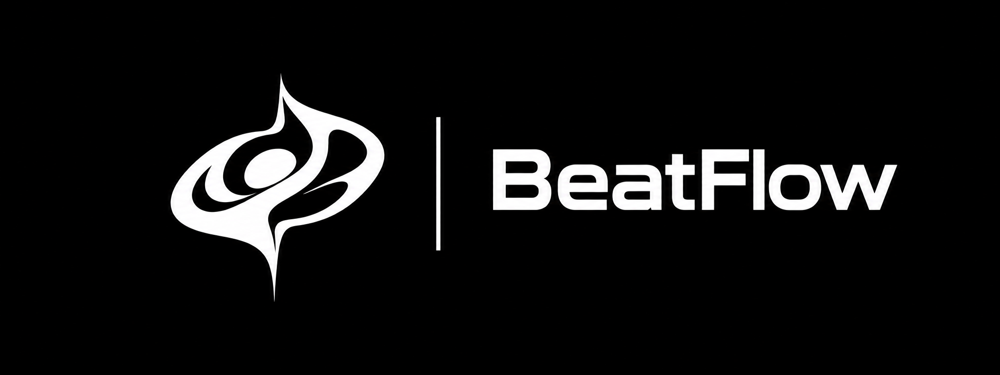

 

# BeatFlow

### A modern YouTube Music client

 

 

[**Download**](#download) · [**Features**](#features) · [**About**](#about) · [**Disclaimer**](#disclaimer)

> [!IMPORTANT]
> BeatFlow is not affiliated with, endorsed by, or connected to YouTube or Google. Use it at your own discretion.

---

<h1>Features</h1>

<table>
  <tr>
    <td width="50%" valign="top">

#### Playback
- Search, browse, and play music from YouTube Music
- High-quality playback with configurable source modules
- Gapless playback and adjustable crossfade
- Background playback
- Offline downloads with embedded metadata
- Local music library integration

#### Connectivity
- Sign in with your Google account
- Spotify integration
- Last.fm and ListenBrainz scrobbling
- Pluggable audio sources

    </td>
    <td width="50%" valign="top">

#### Experience
- Animated album art and dynamic theming
- Word-synced lyrics
- A clean, modern interface
- Material-inspired visual design

#### Controls
- Playback speed controls
- Sleep timer
- Equalizer support
- Per-network audio quality settings

    </td>
  </tr>
</table>

---

<h1>Download</h1>

Get the latest available build from the [Releases](https://github.com/AbhiDevkota/BeatFlow/releases) page.

---

<h1>About</h1>

BeatFlow is a forked adaptation of the original BitChord project. Thank you to the BitChord team for creating the framework and foundation this project builds on.

---

<h1>Disclaimer</h1>

BeatFlow is an independent third-party client. YouTube and Google are trademarks of their respective owners. Use of this software must comply with applicable terms and laws.

---

<h1>License</h1>

This project is licensed under the GNU General Public License v3.0 (GPLv3). See the [LICENSE](LICENSE) file for details.

